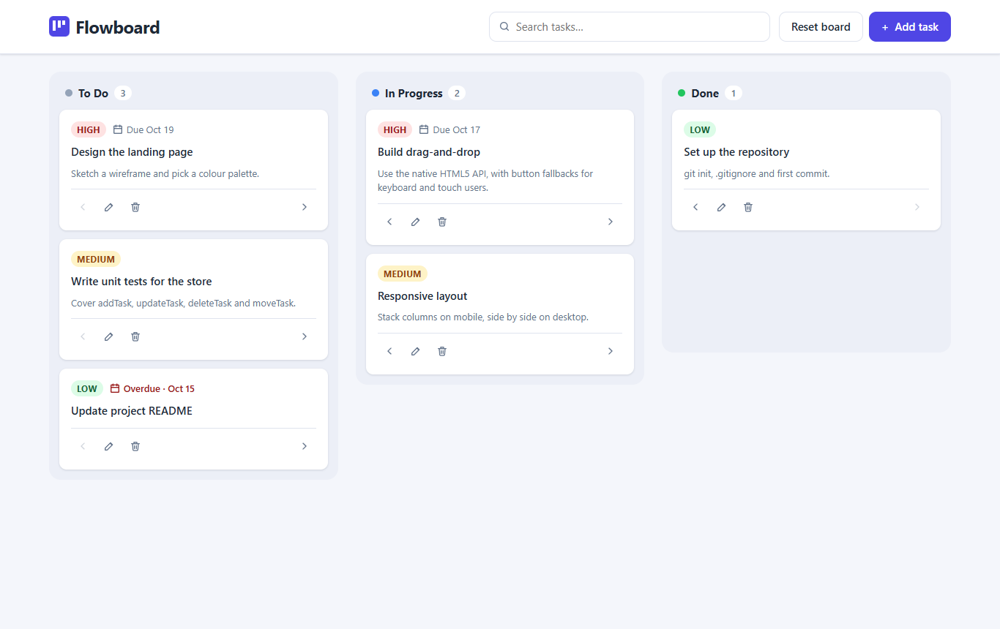

# Flowboard

A lightweight Kanban task board built with plain HTML, CSS and vanilla JavaScript. No frameworks, no libraries, no build step.

**Live demo:** [xyphera.github.io/flowboard-kanban](https://xyphera.github.io/flowboard-kanban/)



## Features

- Three columns (To Do, In Progress, Done), each with a live task count
- Add and edit tasks in a native `<dialog>`: title (required), description, priority (Low / Medium / High) and an optional due date
- Overdue tasks are flagged in red
- Delete with a confirmation dialog
- Drag and drop cards between columns: the dragged card fades and the target column highlights
- Move-left / move-right buttons on every card for keyboard and touch users
- Search that filters cards across all columns
- Tasks persist in `localStorage`. First-time visitors get example tasks, and **Reset board** brings them back
- Responsive: columns sit side by side on desktop and stack on mobile

## Tech

- **HTML5**: semantic landmarks, native `<dialog>`, HTML5 Drag and Drop API
- **CSS3**: custom properties, mobile-first media queries, Grid and Flexbox, BEM naming
- **JavaScript (ES2022)**: ES modules, no dependencies

```
index.html
css/styles.css
js/
  main.js         entry point: wires events to the store
  store.js        the single tasks array plus addTask / updateTask / deleteTask / moveTask
  storage.js      localStorage load and save
  render.js       builds the board DOM from state
  dragDrop.js     HTML5 drag-and-drop handlers
  modal.js        promise-based add/edit and confirm dialogs
  sampleTasks.js  example tasks for first-time visitors
```

## Key front-end decisions

**One data flow: state → save → render.** Every change goes through a function in `store.js`, which updates the tasks array, saves it to `localStorage`, then tells the renderer to rebuild the board. Event handlers never edit card DOM directly, so the screen always matches the data and every change is persisted automatically.

**Event delegation.** The board has one `click` listener and five drag listeners in total, not a set per card. Clicks bubble up to the board, and the handler uses `event.target.closest('[data-action]')` to work out which button on which card was pressed. Cards created by later re-renders work with no extra wiring.

**Drag and drop with an accessible fallback.** The HTML5 Drag and Drop API doesn't work with a keyboard and has little support on touch screens. So every card also has **move left / move right buttons** with descriptive `aria-label`s (e.g. *Move "Design the landing page" to In Progress*). After a move, focus returns to the same button on the re-rendered card, and an `aria-live` region announces the change to screen-reader users.

**XSS-safe rendering.** All user text is inserted with `textContent` and `createElement`, never `innerHTML`. A task titled `` shows up as literal text instead of running as code.

**Native dialogs.** `<dialog>` with `showModal()` traps focus, closes on Escape and makes the page behind it inert, all without extra code. `modal.js` wraps the dialogs in Promises (`const values = await openTaskDialog()`), so calling code reads top to bottom, and focus returns to the button that opened the dialog.

## Running locally

ES modules don't load from `file://` URLs, so serve the folder with any static server:

```bash
npx serve .
# or
python -m http.server
```

Then open the printed localhost URL.

## About this project

Built with AI-assisted development using [Claude Code](https://claude.com/claude-code). I reviewed all of the code and the design decisions.
